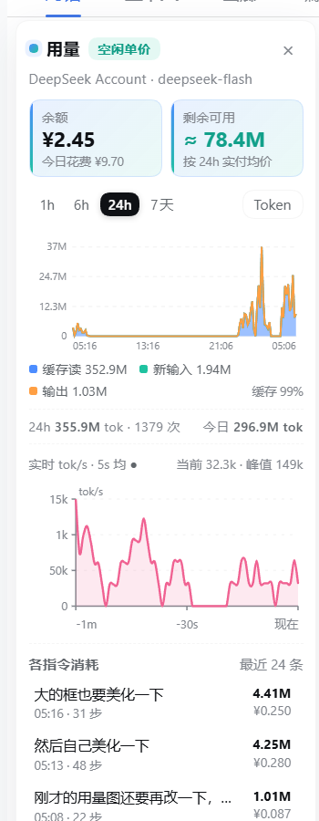
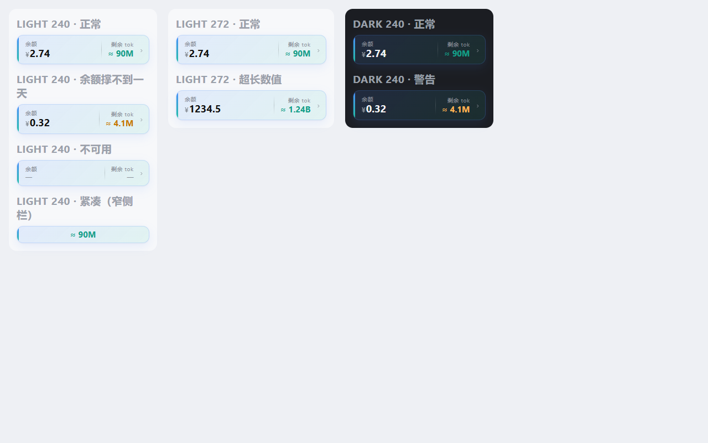

# dsh-usage-wave

给 DeepSeek Harness 的**余额 + 用量**面板：侧栏底部一张余额/剩余 token 卡片，点开是贴在对话栏左侧空白处的用量面板 —— 余额、剩余可用 tok、token/金额堆叠波形（1h/6h/24h/7d）、实时 tok/s 曲线、逐指令消耗。





## 装

在 DSH 的**插件市场**里搜 `dsh-usage-wave` 一键安装，或者手动在 profile 目录下：

```bash
pnpm add dsh-usage-wave
```

装完重启 DSH（bundle 由 `cordis.patch.yml` 装配，宿主侧路由 `/api/usage-wave` 随之生效）。

## 功能

- **侧栏底部卡片**（`sidebar.footer.action`）：`余额` + `剩余 tok` 双列读数，渐变卡面、悬停上浮；余额不足今日流量 1/4 时剩余值转琥珀警告色；点击开合左侧面板，窄侧栏只留一行。
- **左侧面板**（默认展开，`localStorage` 记住开合，× 收起成竖排「用量」把柄）：永远不自己隐藏。宽度 = min(220, 视口 13%)，再被左栏与正文列之间的空白截断，所以不会压正文；上沿贴对话 tab 行下沿，下沿贴窗口底部。
- **读数卡**：`余额`（大号金额 + 今日花费）、`剩余可用`（按最近 24h 实付均价折算的还能跑多少 tok）。
- **波形**：缓存读 / 新输入 / 输出三层堆叠，viewBox 1:1 渲染，坐标文字清晰；图例给三项合计 + 缓存命中率，脚注给窗口总量、请求数、今日总量/花费；hover 出每个分桶的明细。
- **Token / ¥ 金额**两种视图（渠道有价表时才可切）。
- **实时 tok/s**：每秒拉 `?live=1`，滚动显示最近 60 秒（5 秒滑动平均 + Catmull-Rom 平滑曲线）。
- **各指令消耗**：每条用户指令一行，给步数、消耗 tok、花费。

## 数据从哪来

- **余额**：`deepseek-account` 走 DSH 登录账号的 grant（`GET https://api.deepseek.com/user/balance`，头 `x-dsh-auth-token`）；`deepseek-*` API Key 路由读 `DEEPSEEK_API_KEY`。没有可查接口的渠道显示「余额不可用」。
- **用量**：宿主路由 `GET /api/usage-wave?range=...` 读 `$DSH_HOME/sessions/**/*.zstd` 的事件 —— `assistant/message` 的 `usage`（input / cacheRead / output / cacheWrite）+ `data.turn` 分桶；`user/message` 取指令文本；会话文件按 (mtime, size) 缓存，只重解析变化的。
- **金额**：内置 DeepSeek 官方人民币价快照（2026-09-10，高峰/空闲两档；高峰 = 北京时间工作日 9–12、14–18）。价表里没有的渠道不编金额，标「无价」。
- **剩余可用 tok** = 余额 ÷（最近 24h 实付金额 ÷ 最近 24h token），按实际混价折算（本机流量 99% 是缓存读），不是按未命中单价。

## 实现要点

- `lib/index.js`（宿主）：注册 `/api/usage-wave`，聚合会话日志、查余额、算价。
- `lib/client.js`（客户端）：`window.__ModuleLoader__` 模块，模块级 store 单例 + 订阅，所有表面共享一次 15s 轮询（页面隐藏时暂停）。
- 面板**不挂** `shell.overlay`（该槽位自带全屏 mask 会吞掉整个应用点击），而是在底部卡片组件里渲染 `position: fixed` 元素贴左侧。
- 面板是 flex 列：除指令列表外全部 `flex: 0 0 auto`，避免高度不够时把标题行压扁。

## 开发

```bash
pnpm pack          # 出 tgz
curl "http://127.0.0.1:<dsh-web-port>/api/usage-wave?range=24h"   # 仅回环地址可访问
```

## License

MIT
